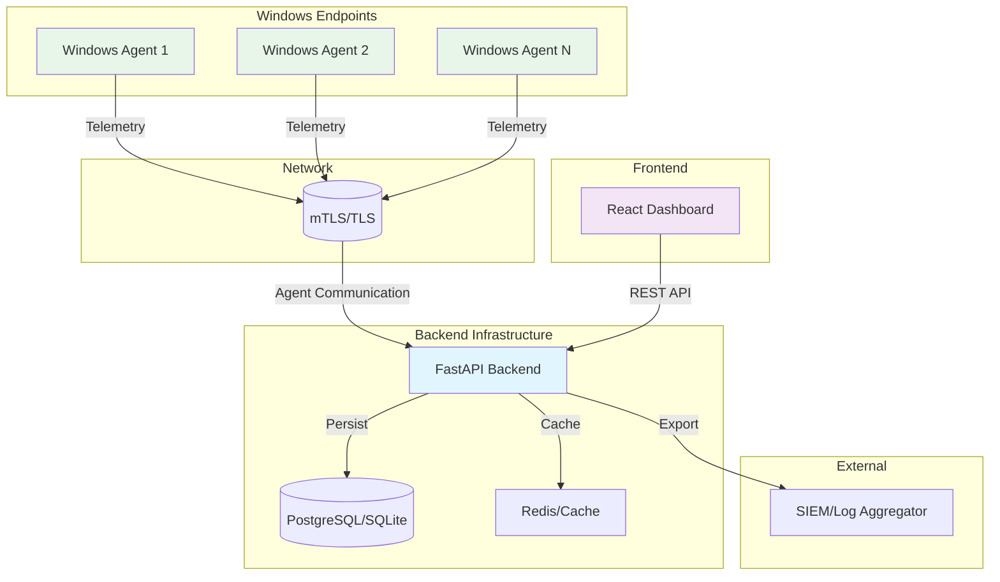
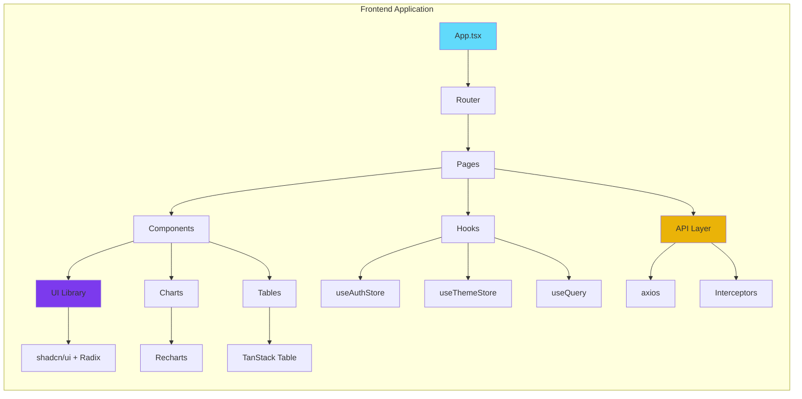
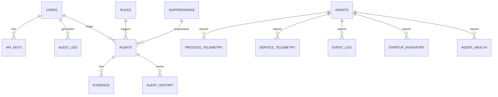
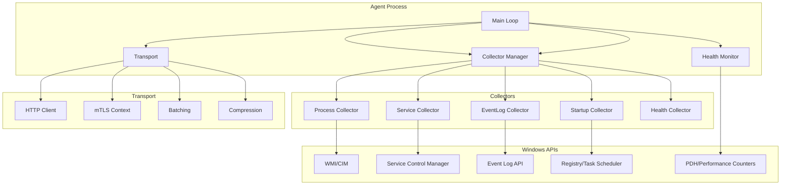
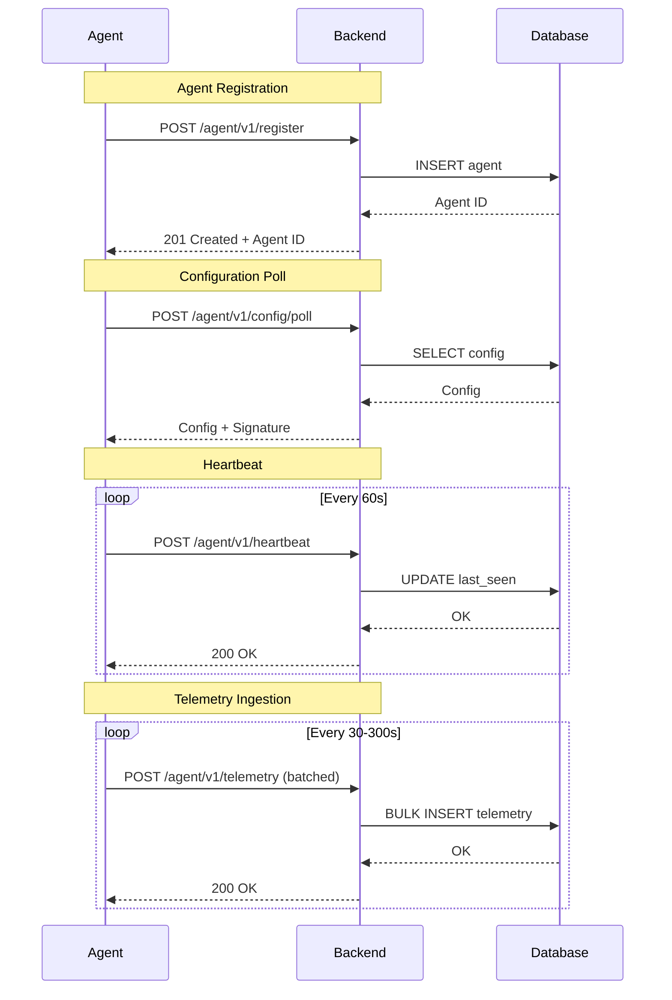
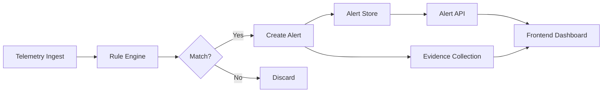
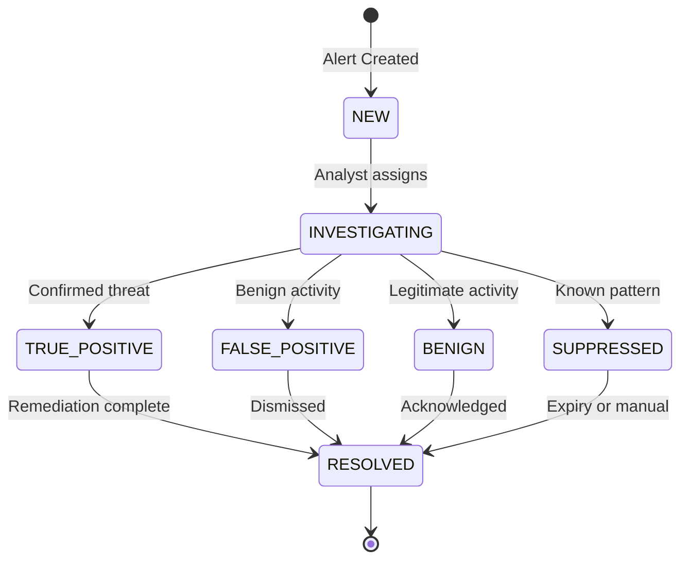
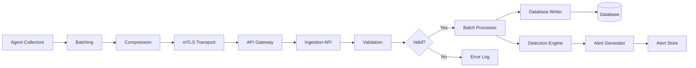
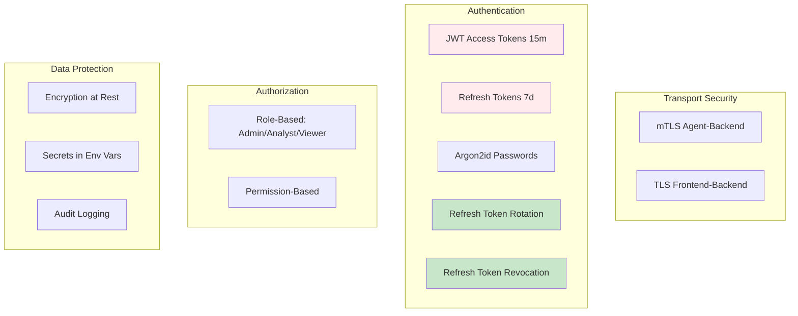
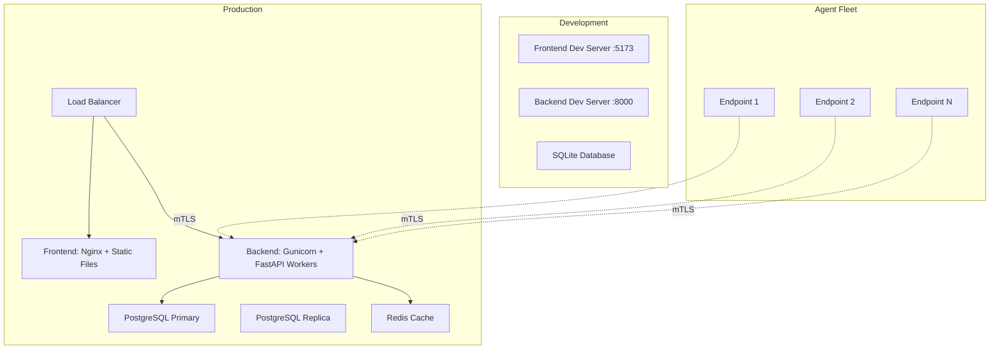

# SentinelWatch System Architecture

**Version:** 1.0
**Date:** 2026-11-12
**Status:** Production Ready (with configuration)

---

## Overview

SentinelWatch is a Windows endpoint monitoring and SOC dashboard platform consisting of three main components:

1. **Windows Agent** - Lightweight monitoring agent deployed on Windows endpoints
2. **Backend API** - FastAPI-based REST API with PostgreSQL/SQLite persistence
3. **Frontend Dashboard** - React/TypeScript SOC dashboard with real-time visualization

---

## High-Level Architecture



---

## Component Architecture

### 1. Frontend Architecture (React/TypeScript)



#### Key Technologies
| Layer | Technology |
|-------|------------|
| Framework | React 18 + TypeScript 5.5 |
| Build | Vite 5.4 |
| Routing | React Router 6 |
| State | Zustand + TanStack Query 5 |
| UI | shadcn/ui + Radix UI |
| Charts | Recharts 2.15 |
| Tables | TanStack Table 8.20 |
| Styling | Tailwind CSS 3.4 |

#### Page Structure
```
src/pages/
├── DashboardPage.tsx          # Overview with metrics & charts
├── AlertsPage.tsx             # Alert listing & triage
├── AlertInvestigationPage.tsx # Deep-dive investigation
├── AgentsPage.tsx             # Agent inventory
├── ProcessesPage.tsx          # Process telemetry
├── ProcessExplorerPage.tsx    # Process tree & details
├── ServicesPage.tsx           # Service inventory
├── ServiceInvestigationPage.tsx # Service security analysis
├── WindowsEventsPage.tsx      # Event log viewer
├── DetectionRulesPage.tsx     # Rule management
├── ReportsPage.tsx            # Report generation
├── AuditPage.tsx              # Audit log
├── SettingsPage.tsx           # User preferences
└── LoginPage.tsx              # Authentication
```

### 2. Backend Architecture (FastAPI)

```mermaid
graph TB
    subgraph "API Layer"
        A[FastAPI App] --> B[Routers]
        B --> C[/api/v1/auth]
        B --> D[/api/v1/agents]
        B --> E[/api/v1/alerts]
        B --> F[/api/v1/telemetry]
        B --> G[/api/v1/rules]
        B --> H[/api/v1/reports]
        B --> I[/api/v1/audit]
        B --> J[/api/v1/suppression]
        B --> K[/api/v1/agent_communication]
    end

    subgraph "Core Services"
        L[Auth Service] --> M[JWT + Argon2id]
        N[Detection Engine] --> O[Rule Evaluation]
        P[Agent Manager] --> Q[Registration/Config]
        R[Telemetry Ingestion] --> S[Batch Processing]
    end

    subgraph "Data Layer"
        T[SQLAlchemy 2.0 Async] --> U[PostgreSQL/SQLite]
        V[Alembic Migrations]
    end

    subgraph "Agent Communication"
        W[Agent API] --> X[mTLS]
        W --> Y[Heartbeat]
        W --> Z[Telemetry Ingestion]
    end
```

#### API Endpoints (58 Total)

| Module | Routes | Description |
|--------|--------|-------------|
| **auth** | 9 | Login, refresh, logout, user management |
| **agents** | 12 | Registration, inventory, config, health |
| **alerts** | 12 | CRUD, triage, resolution, evidence |
| **telemetry** | 18 | Processes, services, events, startup |
| **rules** | 15 | CRUD, built-in, test, promote/demote |
| **reports** | 6 | Alert/endpoint reports, export |
| **audit** | 4 | Audit log, export |
| **suppression** | 6 | Suppression rules CRUD |
| **agent_communication** | 5 | Registration, heartbeat, telemetry |

### 3. Database Architecture



#### Core Tables

| Table | Purpose | Key Fields |
|-------|---------|------------|
| `users` | Dashboard users | id, username, email, password_hash, role, mfa_enabled |
| `api_keys` | API authentication | id, user_id, key_hash, scopes |
| `agents` | Registered endpoints | id, hostname, machine_guid, status, last_seen |
| `process_telemetry` | Process snapshots | id, agent_id, pid, name, cpu, memory |
| `service_telemetry` | Windows services | id, agent_id, name, status, start_type |
| `event_log` | Windows Event Logs | id, agent_id, event_id, level, message |
| `startup_inventory` | Persistence items | id, agent_id, type, path, command |
| `alerts` | Security alerts | id, agent_id, rule_id, severity, status |
| `evidence` | Alert evidence | id, alert_id, telemetry_type, raw_records |
| `audit_log` | Audit trail | id, actor_id, action, resource, result |
| `rules` | Detection rules | id, name, rule_type, condition, severity |
| `suppressions` | Alert suppressions | id, rule_id, pattern, expiry |

### 4. Windows Agent Architecture



#### Agent Components

| Component | Responsibility |
|-----------|----------------|
| **Config Manager** | Polls backend for config, validates signatures |
| **Process Collector** | Enumerates processes via WMI, captures cmdline, hashes |
| **Service Collector** | Enumerates services via SCM, checks binary signatures |
| **EventLog Collector** | Queries Security/System/Application logs |
| **Startup Collector** | Registry Run keys, Task Scheduler, Startup folders |
| **Health Collector** | CPU, memory, disk, network, queue depth |
| **HTTP Client** | Async httpx with connection pooling |
| **mTLS Context** | Certificate validation, mutual auth |
| **Batching** | Configurable size/interval, compression |

### 5. API Communication



### 6. Detection Engine



#### Detection Rule Types

| Type | Description | Example |
|------|-------------|---------|
| **process** | Process behavior | `cmdline contains "powershell -enc"` |
| **service** | Service anomalies | `service_type=kernel AND status=running` |
| **startup** | Persistence | `registry_key=Run AND path=temp` |
| **eventlog** | Event log patterns | `event_id=4688 AND parent=cmd.exe` |
| **correlation** | Multi-event | `process_create + network_connect` |

### 7. Alert Investigation Workflow



### 8. Data Collection Pipeline



---

## Security Architecture



---

## Deployment Architecture



---

## Data Flow Summary

| Flow | Frequency | Volume | Latency |
|------|-----------|--------|---------|
| Agent Heartbeat | 60s | ~1 KB | <100ms |
| Process Telemetry | 30s | ~50 KB | <500ms |
| Service Telemetry | 60s | ~10 KB | <200ms |
| Event Log | 10s | ~5 KB | <100ms |
| Startup Inventory | 3600s | ~100 KB | <1s |
| Health Metrics | 60s | ~2 KB | <100ms |
| Alert Generation | Event-driven | ~1 KB | <500ms |
| Config Poll | 300s | ~5 KB | <200ms |

---

## Scalability Considerations

| Component | Horizontal Scaling | Bottlenecks |
|-----------|-------------------|-------------|
| Frontend | CDN + Static Files | None |
| Backend API | Gunicorn Workers | Database Connections |
| Database | Read Replicas | Write Throughput |
| Agent Ingestion | Partition by Agent ID | Batch Write Throughput |
| Detection Engine | Rule Partitioning | Rule Complexity |
| WebSocket | Redis Pub/Sub | Connection Count |

---

## Monitoring & Observability

| Component | Metrics | Health Check |
|-----------|---------|--------------|
| Backend | Request latency, error rate, queue depth | `/health`, `/ready` |
| Database | Connections, query latency, size | `/ready` checks DB |
| Agent Ingestion | Events/sec, batch size, latency | Heartbeat monitoring |
| Detection Engine | Rules evaluated, alerts/sec, false positive rate | Rule evaluation latency |
| Frontend | Bundle size, load time, errors | N/A |

---

## Security Boundaries

| Boundary | Protection |
|----------|------------|
| Agent ↔ Backend | mTLS + JWT (agent identity) |
| Frontend ↔ Backend | TLS + JWT (user identity) |
| Admin ↔ Backend | TLS + JWT + MFA |
| Database | Network isolation, encryption at rest |
| Secrets | Environment variables only, never in code |

---

## File Structure Summary

```
SentinelWatch/
├── agent/                 # Windows monitoring agent (Python)
│   ├── src/sentinelwatch_agent/
│   │   ├── collectors/    # Process, Service, EventLog, Startup
│   │   ├── transport/     # mTLS, HTTP client, batching
│   │   ├── crypto/        # Certificates, signing
│   │   ├── models/        # Telemetry data models
│   │   └── main.py        # Agent entry point
│   └── tests/
├── backend/               # FastAPI Backend (Python)
│   ├── src/sentinelwatch_backend/
│   │   ├── api/v1/        # 9 router modules
│   │   ├── auth/          # JWT, passwords, tokens
│   │   ├── models/        # SQLAlchemy 2.0 models
│   │   ├── database.py    # Async engine, sessions
│   │   ├── config.py      # Pydantic Settings
│   │   ├── detection_rules/ # Rule engine
│   │   └── main.py        # FastAPI app factory
│   ├── config/            # YAML configuration
│   └── tests/
├── frontend/              # React Dashboard (TypeScript)
│   ├── src/
│   │   ├── pages/         # 13 page components
│   │   ├── components/    # shadcn/ui + custom
│   │   ├── hooks/         # Zustand stores, TanStack Query
│   │   ├── lib/           # API client, utilities
│   │   └── types/         # TypeScript definitions
│   └── package.json
├── detection_rules/       # Detection rule engine
├── docs/                  # Documentation
└── README.md
```

---

## Configuration Matrix

| Environment | Backend Debug | Frontend Dev | Database | TLS | Secrets |
|-------------|---------------|--------------|----------|-----|---------|
| Development | true | Vite Dev Server | SQLite | Optional | `.env` / Defaults |
| Testing | true | Build Preview | SQLite | Optional | `.env.test` |
| Demo | false | Build Preview | PostgreSQL | Required | `.env.demo` |
| Production | false | Nginx Static | PostgreSQL | Required | Vault/Env |

---

## Technology Stack Summary

| Category | Technology | Version |
|----------|------------|---------|
| **Frontend** | React | 18.2 |
| | TypeScript | 5.5 |
| | Vite | 5.4 |
| | Tailwind CSS | 3.4 |
| | shadcn/ui + Radix | Latest |
| | TanStack Query | 5.51 |
| | TanStack Table | 8.20 |
| | Recharts | 2.15 |
| | Zustand | 4.5 |
| **Backend** | FastAPI | 0.110+ |
| | SQLAlchemy | 2.0 |
| | Pydantic | 2.7 |
| | Pydantic Settings | 2.3 |
| | python-jose | 3.3 |
| | passlib + argon2 | Latest |
| | aiosqlite / asyncpg | Latest |
| | Uvicorn/Gunicorn | Latest |
| **Agent** | Python | 3.11+ |
| | WMI / pywin32 | Latest |
| | aiohttp / httpx | Latest |
| | cryptography | Latest |
| **Database** | PostgreSQL | 15+ |
| | SQLite (dev) | 3.35+ |
| | Alembic | 1.11+ |
| **Infrastructure** | Nginx | Latest |
| | Gunicorn | 21+ |
| | Redis | 7+ |
| | Docker | 24+ |

---

*This document represents the current system architecture as of Phase 6.5 preparation. Update with each major release.*
